# TP : Configuration et utilisation de VNC et noVNC

DGI-ESP 2026-2027, L3 GLSI, Services Réseaux Avancés, Dr GUEYE
Étudiants : Emmanuel Ndione et Cheikh Ahmed Tidiane Chérif Ndoye


## 1. Objectif et environnement

L'objectif du TP est de prendre le contrôle d'une machine Linux à distance avec VNC, de sécuriser l'accès avec un tunnel SSH, puis de l'ouvrir depuis un navigateur avec noVNC.

Le serveur est une machine Kali Linux (`kali`, IP 10.7.7.241) avec TigerVNC 1.16.2 et XFCE 4.20.1. Le client est un PC Windows (IP 10.7.5.216) avec RealVNC Viewer 8.6.2. noVNC est installé dans `/opt/noVNC` avec websockify.

Le sujet a été adapté sur trois points :
- la session VNC est `:2` (port 5902) au lieu de `:1` (port 5901), car `:1` est déjà occupé ;
- le fichier de démarrage `xstartup` se trouve dans `~/.config/tigervnc/` pour cette version de TigerVNC ;
- websockify est installé avec `apt` (`python3-websockify`) au lieu de `pip`.

## 2. Partie 1 : installation et configuration du serveur VNC

Mise à jour de la machine :

```bash
sudo apt update && sudo apt upgrade -y
```

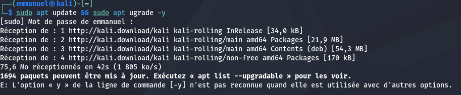

Installation de TigerVNC :

```bash
sudo apt install tigervnc-standalone-server -y
```

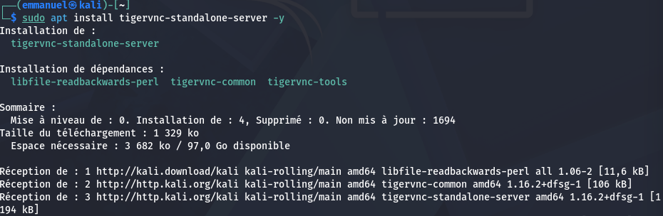

XFCE est déjà présent sur la machine. On installe quand même `xfce4` et `xfce4-goodies` :

```bash
which startxfce4
sudo apt install xfce4 xfce4-goodies -y
```

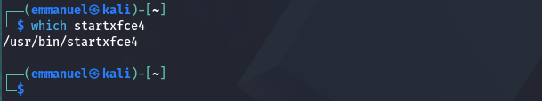

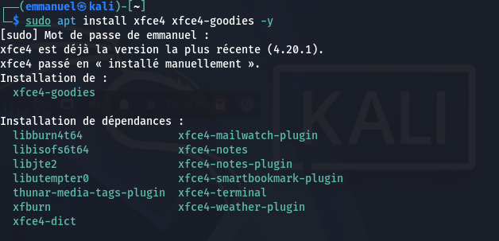

Le sujet demande de lancer `vncserver :1`, mais l'affichage `:1` est déjà utilisé :

```bash
vncserver :1
ls /tmp/.X11-unix/
```

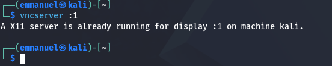

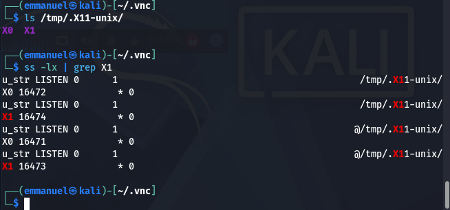

On utilise donc l'affichage `:2`. Le serveur demande un mot de passe, puis écoute sur le port 5902.

```bash
vncserver :2
```

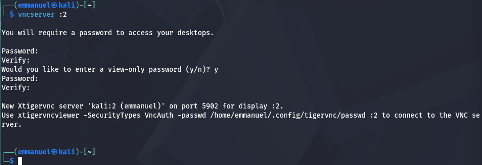

On arrête ensuite le serveur pour configurer le démarrage :

```bash
vncserver -kill :2
```


Création du fichier `xstartup` pour lancer XFCE :

```bash
mkdir -p ~/.vnc
cat > ~/.vnc/xstartup << 'EOF'
#!/bin/bash
xrdb $HOME/.Xresources
startxfce4 &
EOF
```

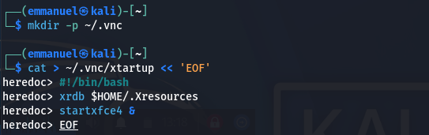

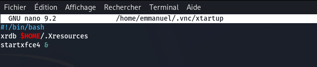

On le rend exécutable et on vérifie :

```bash
chmod +x ~/.vnc/xstartup
ls -la && cat xstartup
```

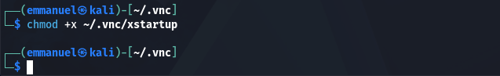

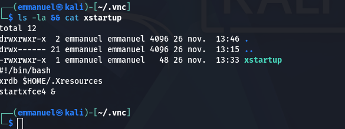

Relance du serveur :

```bash
vncserver :2
```

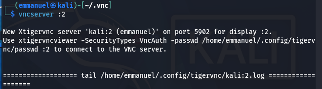

Cette version de TigerVNC ne lit pas `~/.vnc/xstartup`, ce qui a causé un écran noir. La correction est expliquée dans la section 7.

## 3. Partie 2 : connexion depuis la machine cliente

Le client RealVNC Viewer est installé sur le PC Windows.

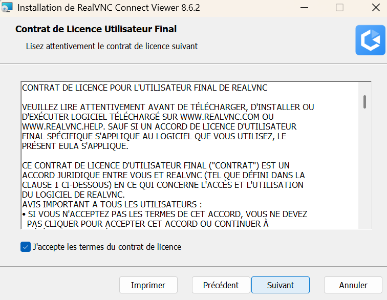

Le sujet propose une connexion directe sur `10.7.7.241:2`. Elle échoue : le port SSH (22) répond, mais le port VNC (5902) est injoignable depuis le PC, sans doute filtré par le réseau de l'établissement.

```powershell
Test-NetConnection 10.7.7.241 -Port 22
TcpTestSucceeded : True

Test-NetConnection 10.7.7.241 -Port 5902
TcpTestSucceeded : False
```

On passe donc par un tunnel SSH (partie suivante). Le test de connexion demandé par le sujet est présenté dans la partie 4, car il est fait à travers ce tunnel.

## 4. Partie 3 : sécurisation avec un tunnel SSH

Sur le PC Windows, on ouvre le tunnel et on laisse la fenêtre ouverte :

```powershell
ssh -L 5902:localhost:5902 emmanuel@10.7.7.241
```

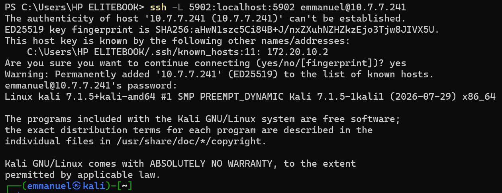

Dans RealVNC Viewer, on se connecte à `localhost:5902`. Le client affiche un avertissement « connexion non chiffrée » : c'est normal, car RealVNC ne voit qu'une connexion locale. Le chiffrement est assuré par le tunnel SSH.

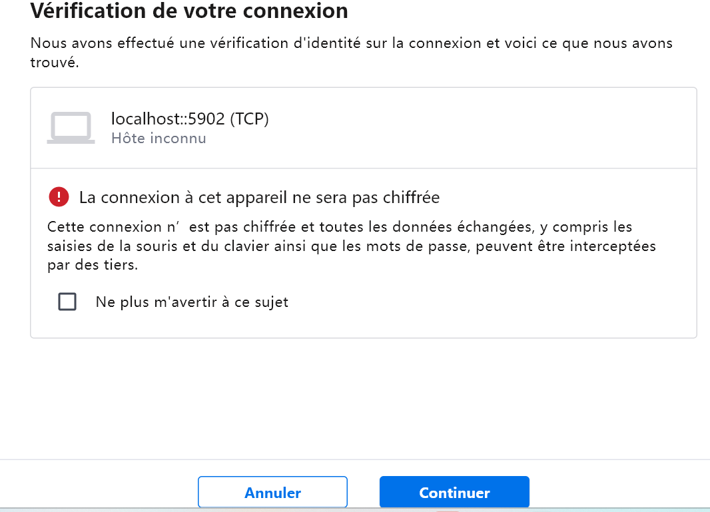

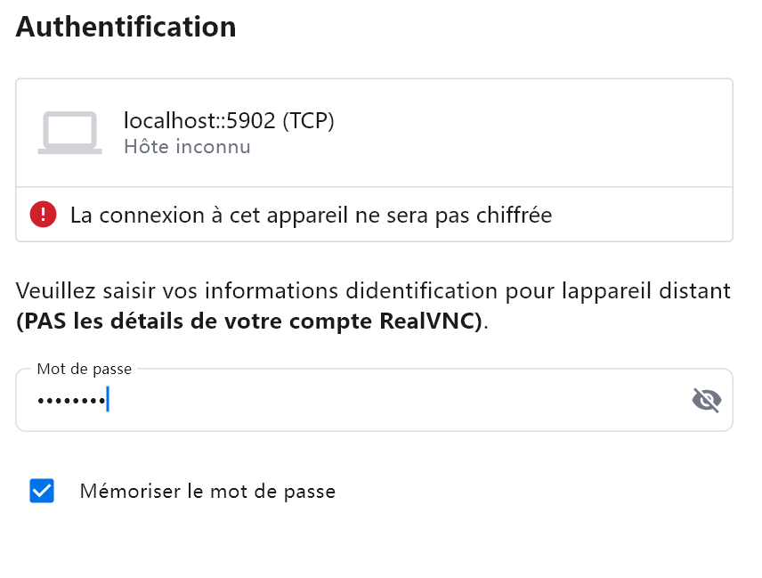

Le bureau XFCE de Kali s'affiche. La fenêtre d'authentification visible est une demande normale de XFCE (gestion des couleurs), sans lien avec VNC.

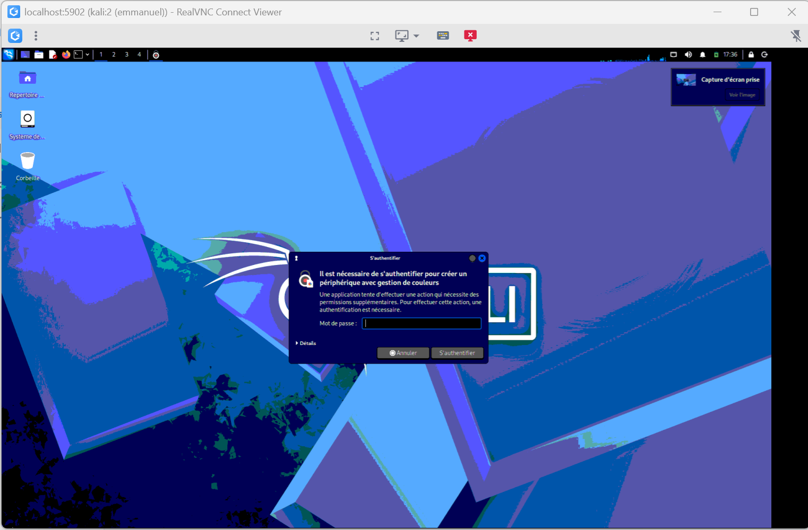

Pour prouver qu'on est bien sur le serveur, on lance `hostname` et `ip a` dans le bureau distant. Le nom est `kali` et l'adresse est 10.7.7.241.

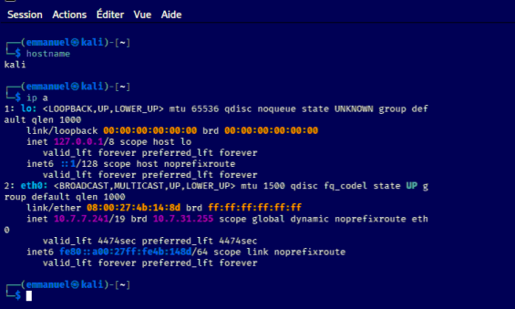

Pour vérifier le passage par SSH, on consulte les journaux du serveur (Kali utilise `journald`) :

```bash
sudo journalctl -u ssh -n 15 --no-pager
```

La ligne `Accepted password for emmanuel from 10.7.5.216` prouve que la connexion vient du PC Windows par SSH.

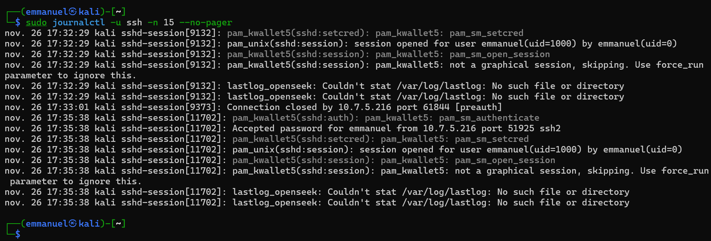

## 5. TP noVNC

### Installation

Le serveur doit avoir accès à internet, ce qui demande une authentification au portail de l'école (voir section 7). On installe ensuite git et websockify :

```bash
sudo apt install git python3-websockify -y
```

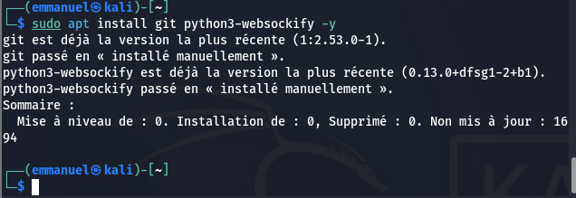

On clone noVNC dans `/opt` :

```bash
cd /opt
sudo git clone https://github.com/novnc/noVNC.git
```

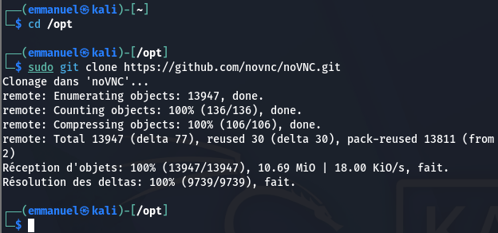

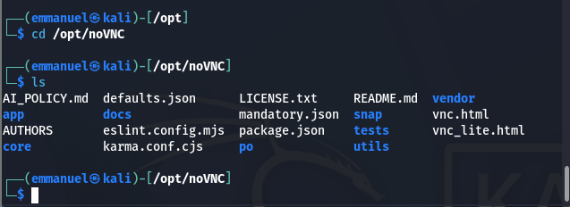

La session VNC et le fichier `xstartup` sont ceux de la partie 1 (session `:2`).

### Lancement de noVNC

On lance le proxy en le pointant vers le port 5902 :

```bash
cd /opt/noVNC
./utils/novnc_proxy --vnc localhost:5902
```

Il écoute sur le port 6080 et relaie vers `localhost:5902`.

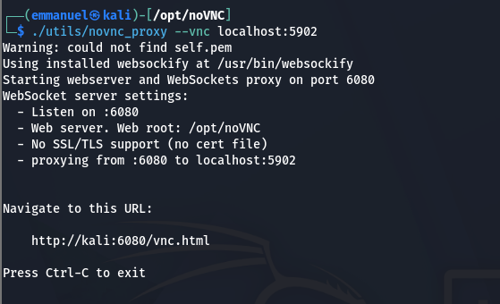

### Accès depuis le navigateur

Comme pour VNC, on passe par un tunnel SSH, cette fois sur le port 6080 :

```powershell
ssh -L 6080:localhost:6080 emmanuel@10.7.7.241
Test-NetConnection localhost -Port 6080
```

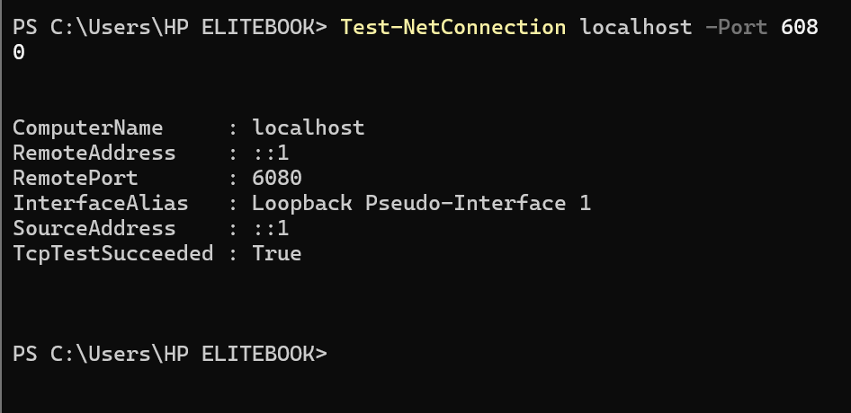

On ouvre ensuite `http://localhost:6080/vnc.html`, puis on clique sur Connecter et on entre le mot de passe VNC.

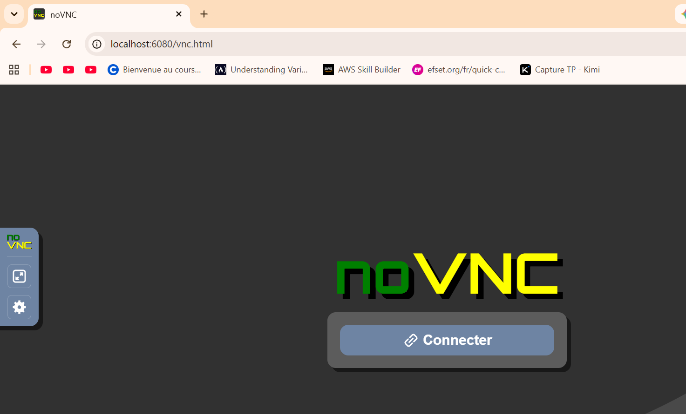

### Démarrage automatique

Deux services `systemd` démarrent VNC et noVNC avec la machine. Le service VNC est `/etc/systemd/system/vncserver.service` :

```ini
[Unit]
Description=TigerVNC session :2
After=network.target

[Service]
Type=simple
User=emmanuel
ExecStartPre=-/usr/bin/tigervncserver -kill :2
ExecStart=/usr/bin/tigervncserver :2 -localhost no -fg
ExecStop=/usr/bin/tigervncserver -kill :2
Restart=on-failure

[Install]
WantedBy=multi-user.target
```

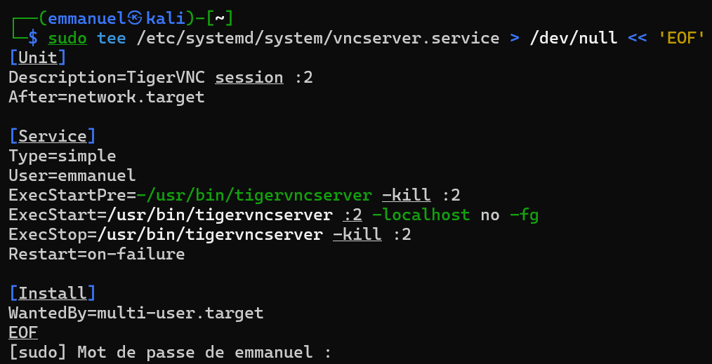

Le service noVNC est `/etc/systemd/system/novnc.service`. Voici sa version finale. La capture montre la première version, sans les lignes `ExecStartPre`, `RestartSec` et `StartLimitIntervalSec` ajoutées ensuite (voir section 7).

```ini
[Unit]
Description=noVNC proxy
After=vncserver.service
Requires=vncserver.service
StartLimitIntervalSec=0

[Service]
Type=simple
User=emmanuel
ExecStartPre=/bin/bash -c 'until ss -tln | grep -q ":5902 "; do sleep 1; done'
ExecStart=/opt/noVNC/utils/novnc_proxy --vnc localhost:5902
Restart=on-failure
RestartSec=5

[Install]
WantedBy=multi-user.target
```

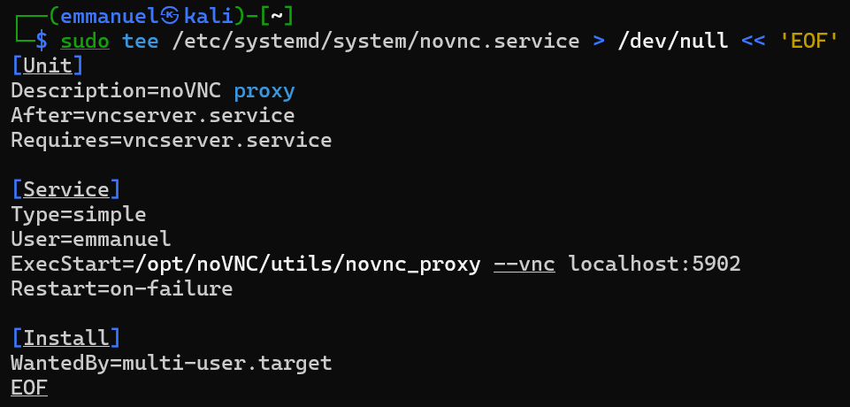

On active et on lance les deux services :

```bash
sudo systemctl daemon-reload
sudo systemctl enable --now vncserver.service novnc.service
```


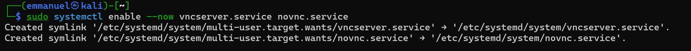

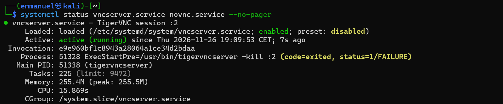

Le code d'erreur de `ExecStartPre` est sans conséquence : cette commande tente d'arrêter une session qui n'existe pas encore, et le `-` devant fait ignorer l'erreur.

Après correction de noVNC (section 7), les deux services sont actifs :

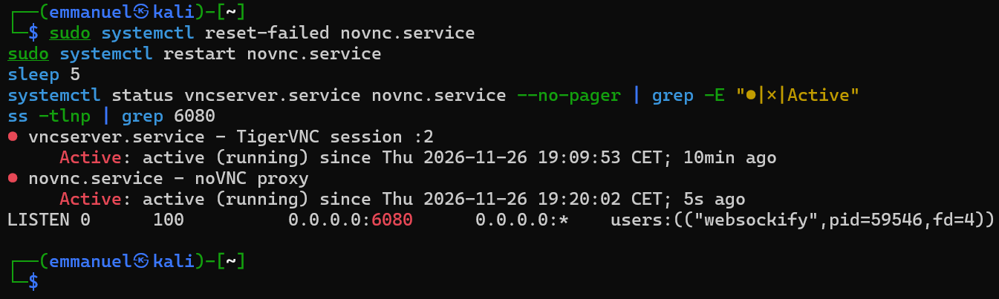

On redémarre ensuite la machine pour tester le démarrage automatique :

```bash
sudo reboot
```

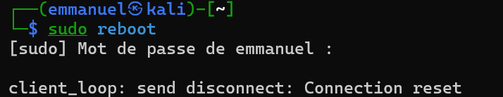

Après le redémarrage et la réouverture du tunnel, la page noVNC est de nouveau servie sans aucune commande manuelle.

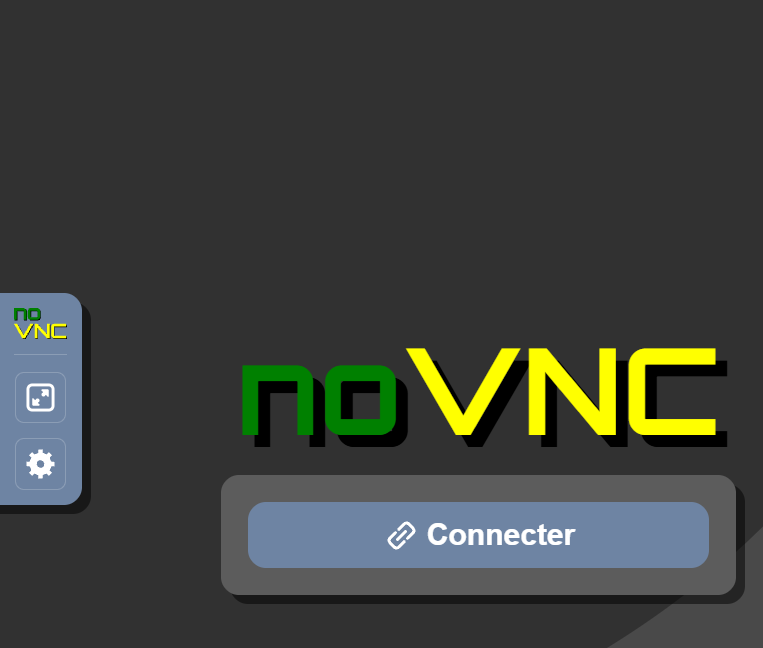

## 6. Questions de réflexion

Utilité de websockify : un navigateur ne sait pas parler le protocole VNC (RFB, en TCP brut), il ne connaît que HTTP et WebSocket. Websockify fait la traduction : il reçoit les connexions WebSocket du navigateur et les relaie en TCP vers le serveur VNC. Il sert aussi les fichiers web de noVNC sur le port 6080.

Différences entre noVNC et les clients VNC standards : noVNC est un client JavaScript qui tourne dans le navigateur, sans installation et sur tout appareil. Un client standard (RealVNC, TigerVNC Viewer) est une application à installer, qui se connecte directement au port VNC sans intermédiaire.

Avantages de noVNC : aucune installation côté client, fonctionne partout où il y a un navigateur, simple à utiliser. Inconvénients : un peu moins performant, moins de fonctionnalités (transfert de fichiers, audio), un composant de plus à maintenir (websockify), et un port 6080 en HTTP non chiffré qui impose un tunnel SSH ou HTTPS. Une application native est plus complète et plus rapide, mais demande une installation.

## 7. Problèmes rencontrés et solutions

Affichage :1 occupé. `vncserver :1` est refusé (voir les captures de la partie 1). On utilise `:2` et donc le port 5902.

Session fermée puis écran noir. Le journal indique que la session se termine trop tôt. La version de TigerVNC lit `~/.config/tigervnc/xstartup` et non `~/.vnc/xstartup`, et XFCE tentait de démarrer en Wayland alors que VNC utilise X11.

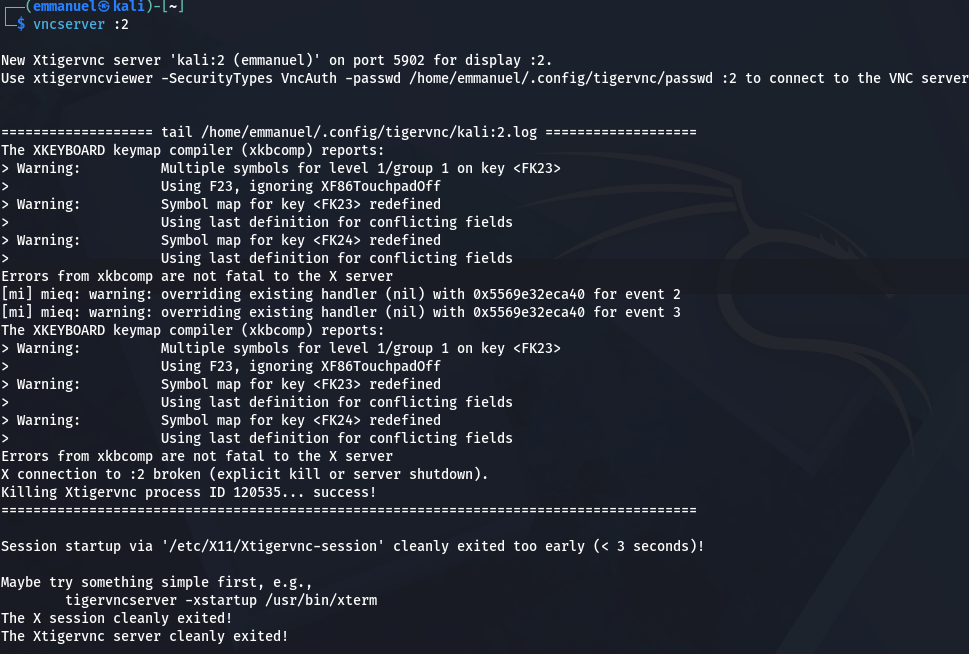

La solution est de créer `~/.config/tigervnc/xstartup` en forçant X11, puis de relancer la session :

```bash
#!/bin/bash
unset SESSION_MANAGER
unset DBUS_SESSION_BUS_ADDRESS
unset WAYLAND_DISPLAY
export XDG_SESSION_TYPE=x11
export GDK_BACKEND=x11
xrdb $HOME/.Xresources
exec startxfce4
```

```bash
chmod +x ~/.config/tigervnc/xstartup
vncserver -kill :2
tigervncserver :2 -localhost no
```

Port 5902 injoignable depuis le PC. La solution est le tunnel SSH et la connexion sur `localhost:5902` (partie 3).

Portail captif. Les téléchargements (`apt`, `git`) échouent, et `curl` est redirigé vers le portail étudiant. L'authentification faite sur le PC ne vaut pas pour le serveur : il faut se connecter au portail depuis le navigateur du serveur.

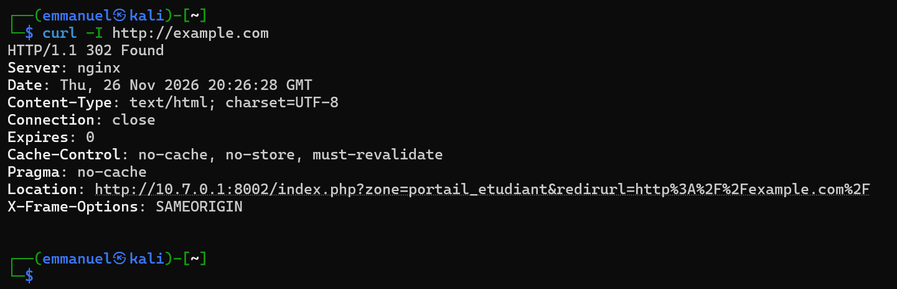

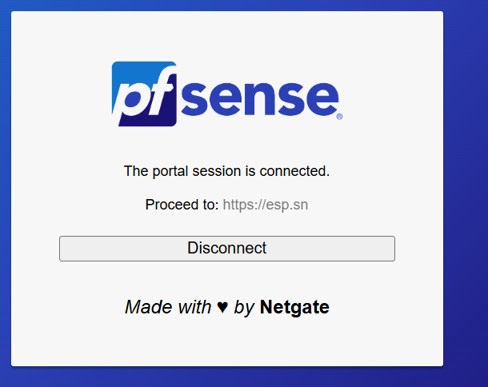

`novnc.service` en échec. Le service boucle en redémarrage et le journal indique `Port 6080 in use` : l'ancien proxy lancé à la main occupait encore le port. De plus, au premier démarrage, le service se lançait avant que le port 5902 soit prêt.

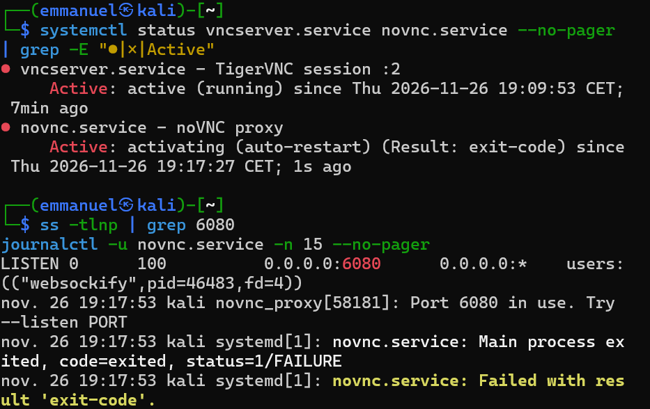

La solution est d'arrêter l'ancien processus, puis de relancer le service avec la version finale du fichier (qui attend le port 5902) :

```bash
sudo kill 46483
sudo systemctl reset-failed novnc.service
sudo systemctl restart novnc.service
```

## 8. Conclusion

Ce TP a permis de mettre en place un serveur TigerVNC avec XFCE, une connexion avec RealVNC sécurisée par un tunnel SSH, un accès depuis un navigateur avec noVNC et websockify, et le démarrage automatique des services avec `systemd`. Les difficultés rencontrées (affichage occupé, emplacement du fichier `xstartup`, Wayland, portail captif, ordre de démarrage des services) ont permis de mieux comprendre VNC, `systemd` et la sécurisation d'un accès distant.
